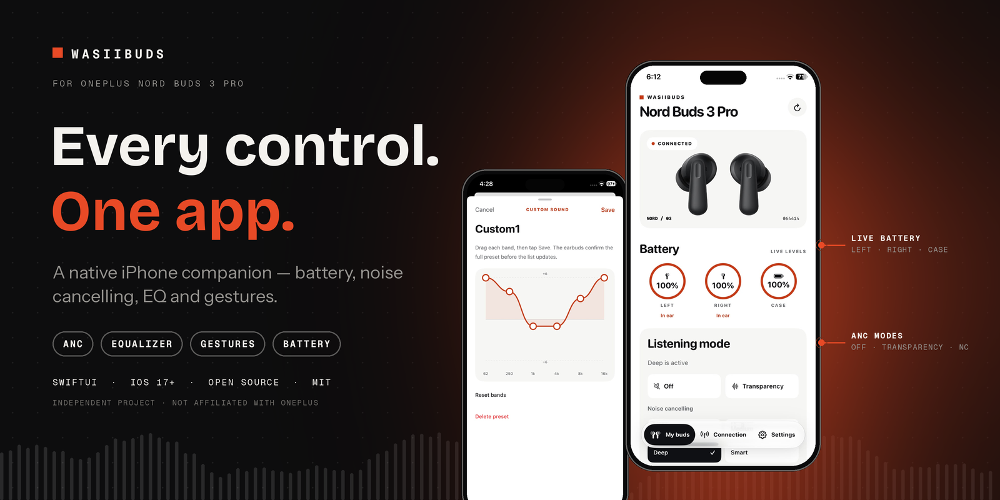

# WasiiBuds



[](https://github.com/evildevill/WasiiBuds/actions/workflows/domain-tests.yml)


[](LICENSE)

**A native iPhone companion for OnePlus Nord Buds 3 Pro.** WasiiBuds shows live earbud state and provides controls for listening modes, sound, and device settings through the earbuds' Bluetooth control connection. It is an independent project and is not affiliated with OnePlus or HeyMelody.

The app is built with SwiftUI, Swift Package Manager, and [xtool](https://xtool.sh/). It has no account, analytics service, or network backend.

## Compatibility

| Earbuds | Model ID | Status |
| --- | --- | --- |
| OnePlus Nord Buds 3 Pro | `064414` | Supported and tested with one iPhone and one firmware version |
| Other OnePlus, OPPO, or realme earbuds | — | Not supported or tested |

Bluetooth service similarity does not establish compatibility. Other models may have different registration, feature bits, command values, and firmware behavior. See [Contributing](CONTRIBUTING.md) for the evidence needed to add a model.

**Requirements:** iPhone running iOS 17 or later, Nord Buds 3 Pro paired in iPhone Bluetooth settings, Bluetooth permission for WasiiBuds, and an unlocked iPhone with Developer Mode enabled for a local install. Pairing and audio routing remain in iOS.

## Features

Status means **verified** when the behavior was observed on the test iPhone, **implemented** when the code and protocol handling exist but the physical effect still needs checking, and **limited** when the earbuds or build tooling have not supplied the result needed for a working feature.

| | Feature | Status | What WasiiBuds does |
| --- | --- | --- | --- |
| 🔗 | Bluetooth control connection | Verified | Finds the earbuds, opens the control channel, reconnects, and reports permission or connection errors. |
| 🔋 | Battery | Verified for left and right | Shows the levels and charging flags the earbuds report. Case level appears only when the buds include it. |
| 🎧 | Listening modes | Verified | Switches Off, Transparency, and available noise cancelling strengths; follows the earbuds' reported mode. |
| 👆 | Touch gestures | Implemented | Reads each bud's gesture table, changes supported media actions, and checks the result after a write. |
| 📞 | Call gestures | Answer and decline verified | Double tap answered a ringing call; an **extended hold** declined one. Ending an active call was not separately tested. The call actions are a read-only guide because this model does not expose editable call choices. |
| 🎚️ | Equalizer | Implemented | Built-in presets, three custom six-band presets, and BassWave controls where advertised by the earbuds. Audibility and every preset path still need a full device pass. |
| ⚡ | Low latency and audio switches | Implemented | Shows only switches reported by firmware. High-quality audio is a device switch, not an iPhone codec selector; 3D audio's audible effect is unverified. |
| 🔄 | Dual connection | Implemented | Reads the toggle and paired-device list. Pairing and choosing the active audio route happen outside WasiiBuds. |
| 👂 | Wear and fit | Implemented | Shows reported in-ear state and offers a fit test when the firmware advertises it. The fit result still needs device confirmation. |
| 📍 | Find earbuds | Implemented | Requests a sound on both buds, with an automatic stop. The physical result still needs checking. |
| 🧩 | Device settings | Implemented | Includes auto play/pause and personalized ANC when the buds report those settings. |
| ℹ️ | Firmware and device details | Implemented | Reads separate left, right, and case firmware versions. Missing values are shown as **Not reported**. No firmware flashing is offered. |
| 🦻 | Hearing profile | Limited | Reads stored profile state, but the tested iPhone received no hearing-test tone confirmation; the same test also produced no tones in HeyMelody. WasiiBuds does not claim a completed test without the device's result. |
| 📱 | Home Screen widget | Source available | Battery and ANC widget code exists, but the extension is **not included in the current installed app** because of an xtool signing issue. |

The device, not the app, ultimately applies sound settings. WasiiBuds waits for a device reply or readback before treating most changes as saved. A successful Bluetooth connection does not guarantee a feature is supported by the connected firmware.

## Build and install

Clone the repository and install [Swift](https://www.swift.org/install/) and [xtool](https://xtool.sh/documentation/xtool/). From the project root:

```sh
xtool dev build
xtool dev run --usb
```

On a Linux system where the xtool AppImage cannot use FUSE, prefix either command with `APPIMAGE_EXTRACT_AND_RUN=1`. The build produces `xtool/WasiiBuds.app`. `xtool dev run --usb` builds, signs, and installs to a connected iPhone using the local development setup. It does not publish an App Store build.

After installation, open WasiiBuds on the phone and allow Bluetooth access. Keep the buds paired for audio in iOS Settings. If two similarly named Bluetooth entries appear, the app's **Connection** screen shows which one has the control service.

### Tests

Run the protocol, model, and widget snapshot tests on Linux or macOS:

```sh
scripts/test-domain.sh
```

The script creates a temporary Swift package containing `BudsDomain`, `BudsStorage`, `BudsWidgetData`, and their tests, then removes it. This keeps Linux tests independent of SwiftUI, CoreBluetooth, and WidgetKit. The same command runs in [CI](.github/workflows/domain-tests.yml). Run `xtool dev build` as the separate iOS compilation check; tests alone do not verify the iPhone interface or Bluetooth behavior.

## Using the app

1. **My buds:** view battery, wear status, and listening mode. Pull down to refresh; the screen also supports a two-finger pinch refresh.
2. **My buds → Sound:** open Equalizer for built-in or custom six-band profiles. Adjust BassWave only when the device advertises it; Dual connection is also reached here.
3. **Connection:** inspect connection state, nearby devices, discovered services, and recent control activity when diagnosing a problem.
4. **Settings:** configure available preferences and per-bud media gestures, run Find or fit test, and open the read-only firmware page.

For call handling, double tap to answer. To decline a ringing call, keep holding **past the first noise-control response** until the extended hold registers. A regular hold changes noise control. Answer and decline were confirmed on the test iPhone; ending an active call still needs a separate check. WasiiBuds does not remap these actions.

## Architecture

| Target | Responsibility |
| --- | --- |
| `BudsDomain` | Platform-independent frames, parsers, model settings, battery, ANC, EQ, gestures, wear, and device replies. |
| `WasiiBuds/Bluetooth` | CoreBluetooth discovery and connection, request sequencing, readback, reconnection, timeouts, and UI-facing state. |
| `BudsStorage` | Local hearing-profile persistence and record validation. |
| `WasiiBuds/Features` | SwiftUI screens and controls, including Settings, Equalizer, gestures, and firmware details. |
| `BudsWidgetData` | Shared widget snapshot model. |
| `WasiiBudsWidget` | Widget source; not bundled in the current iPhone build. |
| `BudsDomainTests`, `BudsStorageTests`, `BudsWidgetDataTests` | Packet, model, persistence, and widget freshness regression tests. |

The app does not send data to a server. Bluetooth identifiers stay in memory; hearing profile records are stored locally on the iPhone. The widget snapshot, when an extension can be shipped, uses the configured App Group. Review [Security](SECURITY.md) before sending diagnostic logs, since device identifiers can appear there.

The Bluetooth implementation is organized by responsibility within the app target: `BluetoothExplorer.swift` owns the session, transport queue, and CoreBluetooth delegate callbacks; `+Responses` routes frames; and the `+Sound`, `+Accessories`, and `+HearingProfile` files handle feature commands and replies. Keeping the Objective-C delegate callbacks beside the class also ensures the built iOS binary exposes the selectors CoreBluetooth calls at launch.

## Current limits

- **Case battery and charging:** shown only when present in a battery reply. An empty case value is not guessed from the buds' levels.
- **Audio transport:** iOS handles pairing, calls, and audio routing. WasiiBuds uses a separate control connection and does not select AAC, SBC, or another codec.
- **Hearing test:** unavailable when the earbuds do not complete the scan or confirm tones. A local spinner or acknowledged command is not a test result.
- **Firmware updates:** the details page is read-only. Flashing firmware is outside this project's current scope.
- **Widgets:** the extension source is present, but xtool 1.21.0 could not sign its extension stub in this setup ([issue #379](https://github.com/xtool-org/xtool/issues/379)); widget entry has a separate upstream issue ([#313](https://github.com/xtool-org/xtool/issues/313)). The widget must be built, installed, and tested on an iPhone before being advertised as available.

## Good next features

1. **Sanitized diagnostics export:** let users share command outcomes and firmware details without exposing Bluetooth identifiers.
2. **Connection recovery controls:** a clearer reconnect flow with last successful refresh time and a manual retry.
3. **Battery alerts:** local notifications for low left or right battery, subject to the state iOS actually delivers while the app is running or backgrounded.
4. **Widget release:** package and sign the existing extension once the toolchain path is verified, then test its battery freshness and ANC deep links on a phone.
5. **More models:** add devices one at a time with real GATT captures, registration data, model-specific capability gates, tests, and an owner willing to validate on hardware.

## Troubleshooting

| Symptom | Check |
| --- | --- |
| Buds play audio but WasiiBuds says disconnected | Audio pairing and the control connection are separate. Confirm Bluetooth permission, open the case, then refresh or reconnect in **Connection**. |
| A setting stays on its old value | Wait for the device readback. Check **Connection → Recent activity** for a refusal, timeout, or reconnect. |
| Case level is blank | Open the case and refresh. The app leaves the value blank when the earbuds omit it. |
| HeyMelody shows an old gesture after a change | Close and reopen HeyMelody so it reads the current setting from the earbuds. |
| Hearing test never plays tones | This path has not completed on the tested iPhone; do not assume a profile was created. |

When filing a bug, include the iPhone model, iOS version, earbud firmware versions from **Settings → Device details**, steps to reproduce, and a redacted screenshot of recent activity. See [Contributing](CONTRIBUTING.md).

## License and attribution

The project's original code and documentation are released under the [MIT License](LICENSE). Product names and trademarks belong to their owners. The bundled product image has separate rights and is **not** granted under MIT; see [Third-party notices](THIRD_PARTY_NOTICES.md) before redistributing assets or publishing a release.
